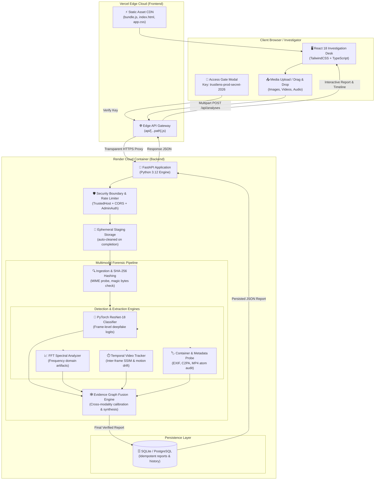

# TRUSTLENS — Multimodal AI Media Forensics & Deepfake Detection Platform

[](https://python.org)
[](https://fastapi.tiangolo.com)
[](https://pytorch.org)
[](https://react.dev)
[](https://tailwindcss.com)
[](https://render.com)
[](https://vercel.com)

**TRUSTLENS** is an enterprise-grade multimodal media forensics and deepfake investigation platform. It provides forensic analysts, journalists, and security teams with verified authenticity assessments across images, video sequences, and audio tracks using calibrated deep learning, frequency-domain signal analysis, temporal motion tracking, and container provenance auditing.

---

## 🔐 Workspace Sign-In & Access Key

When running with access control enabled (such as the hosted production deployment), the investigation desk is protected with an authentication gate:

> ### 🔑 **Sign-In Access Key:**
> ```
> trustlens-prod-secret-2026
> ```

- **Where to enter:** Enter this key in the **Access Key** prompt on the frontend to unlock the investigation workspace and start new analyses.
- **Configurable via:** `TRUSTLENS_ADMIN_KEY` environment variable in the backend.
- **Security:** Protected against brute-force attacks by an automatic sliding-window rate limiter (5 failed attempts per minute locks out the IP for 60 seconds).

---

## 📊 How the Entire System Works (End-to-End Flowchart)



---

## 🏛️ System Architecture

TRUSTLENS is architected as two decoupled systems:

```
.
├── backend/                  # FastAPI & PyTorch forensics service
│   ├── checkpoints/          # Trained PyTorch model weights (best_model.pt)
│   ├── ml_pipeline/          # ML evaluation, cross-validation, and training scripts
│   ├── tests/                # 101 automated unit/integration tests & media fixtures
│   ├── trustlens/            # Core library (service, fusion graph, persistence, web API)
│   ├── requirements.txt      # Production Python requirements
│   ├── requirements-dev.txt  # Test dependencies
│   └── README.md             # Backend setup & testing guide
│
├── frontend/                 # React 18 + TypeScript single-page application
│   ├── src/                  # React views, components, state context, API client
│   ├── static/               # HTML entry point, Tailwind CSS, compiled bundle.js
│   ├── package.json          # Node dependencies & npm scripts
│   ├── tsconfig.json         # TypeScript configuration
│   ├── webpack.config.js     # Webpack bundler & devServer configuration
│   └── README.md             # Frontend setup & testing guide
│
├── api/                      # Vercel Serverless Edge API Gateway ([...path].js)
├── Dockerfile                # Multi-stage production container for Render / Docker
├── render.yaml               # Render infrastructure-as-code specification
├── vercel.json               # Vercel static routing, edge rewrites & security headers
└── README.md                 # Root project documentation
```

---

## 🛠️ Build & Run Commands

### 1. Frontend Commands

From the `frontend/` directory:
```bash
cd frontend
```

| Task | Command | Description |
|:---|:---|:---|
| **Install Dependencies** | `npm install` | Installs React, TypeScript, Tailwind, Webpack, and dev dependencies |
| **Build for Production** | `npm run build` | Compiles TypeScript & Tailwind into `frontend/static/bundle.js` |
| **Development Server** | `npm run dev` *(or `npm start`)* | Starts dev server on `http://localhost:3000` with hot reload & API proxy |
| **Run Unit Tests** | `npm test` | Runs Jest test suite with React Testing Library |
| **Lint & Format** | `npm run lint` | Runs ESLint across `src/` |

---

### 2. Backend Commands

From the `backend/` directory:
```bash
cd backend
```

| Task | Command | Description |
|:---|:---|:---|
| **Create Virtualenv** | `python -m venv .venv` | Creates Python 3.11+ virtual environment |
| **Activate Virtualenv** | `.\.venv\Scripts\Activate.ps1` | Activates environment in PowerShell *(Linux/macOS: `source .venv/bin/activate`)* |
| **Install Dependencies** | `pip install -r requirements.txt` | Installs FastAPI, PyTorch, OpenCV, psycopg, etc. |
| **Install Dev Dependencies** | `pip install -r requirements-dev.txt` | Installs testing tools (`httpx`, `pytest`, etc.) |
| **Start Backend Server** | `python -m trustlens.web` | Starts FastAPI on `http://127.0.0.1:8765` |
| **Run Unit Test Suite** | `python -m unittest discover -s tests -v` | Runs all 101 automated unit and integration tests |
| **Run Smoke Test** | `python tests/http_restart_smoke.py` | Validates process restart, DB persistence, and cleanup |

---

## 🌐 Cloud Deployment Guide

TRUSTLENS is configured for dual-cloud deployment: **Render** (for the GPU/Docker ML backend) and **Vercel** (for the edge React frontend).

### Step 1: Deploy Backend on Render

1. Create a new **Web Service** on [Render](https://render.com) from your GitHub repository.
2. Select **Docker** as the runtime (it automatically picks up `Dockerfile` and `render.yaml`).
3. Add the following **Environment Variables** in Render's dashboard:

| Key | Recommended Value | Description |
|:---|:---|:---|
| `TRUSTLENS_HOST` | `0.0.0.0` | **Required.** Allows external ingress through Render's router. |
| `TRUSTLENS_ALLOWED_HOSTS` | `*` | **Required.** Allows Render's `*.onrender.com` domain. |
| `TRUSTLENS_ADMIN_KEY` | `trustlens-prod-secret-2026` | Secret key required to access privileged endpoints. |
| `TRUSTLENS_ENV` | `production` | Enables production mode. |
| `TRUSTLENS_PORT` | `10000` | Port for incoming traffic (Render also provides `$PORT`). |
| `TRUSTLENS_REQUIRE_AUTH` | `false` | Set to `false` for open demo, or `true` to require key. |
| `TRUSTLENS_DB_PATH` | `/app/data/analyses.sqlite3` | SQLite database file location inside container. |
| `TRUSTLENS_TEMP_DIR` | `/app/temp` | Temporary staging folder for uploaded files. |
| `TRUSTLENS_MODEL_PATH` | `/app/checkpoints/best_model.pt` | Path to the PyTorch detector weights file. |

Once deployed, note your backend URL (e.g., `https://trustlens-backend.onrender.com`).

---

### Step 2: Deploy Frontend on Vercel

1. Import your GitHub repository in [Vercel](https://vercel.com).
2. Set **Framework Preset** to **Other** *(Vercel reads `buildCommand` and `outputDirectory` from `vercel.json`)*.
3. In **Settings → Environment Variables**, add:

| Key | Value | Description |
|:---|:---|:---|
| `TRUSTLENS_BACKEND_URL` | `https://your-backend.onrender.com` | **Required.** Connects the Vercel edge gateway to your live Render backend. |

4. Click **Deploy**. Vercel will bundle the React frontend, serve static assets via global CDN, and route all `/api/*` calls directly to your Render backend.

---

## 🛡️ Forensic Integrity & Privacy Guarantees

- **No Fabricated Confidence**: When ML models are unavailable or uncalibrated, the pipeline returns explicit status indicators (`unavailable`, `partial`) rather than inventing probabilities.
- **Immediate Artifact Purging**: Uploaded media files and derived frames are removed from ephemeral storage immediately upon report synthesis.
- **Cryptographic Traceability**: Every analysis report includes the SHA-256 source hash, tool version, detector checkpoint signature, and structured provenance timestamps.
- **Single-Origin Loopback Default**: Local execution binds strictly to `127.0.0.1` to prevent unauthorized network exposure.
